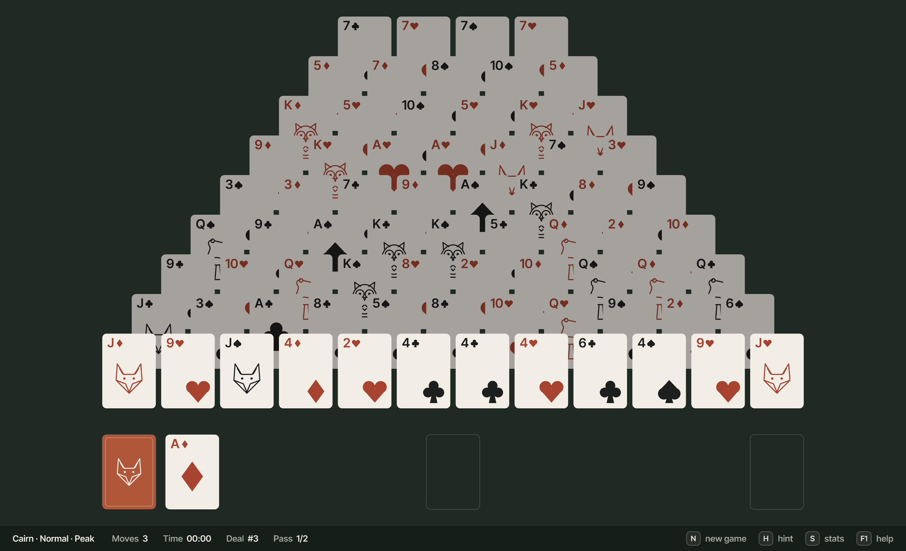

# Soli

Soli is a small collection of solitaire card games for the desktop, written in
Rust. Everything on screen is drawn from primitives at runtime (cards, suits and
the line-art animals on the backs and court cards), so the only asset is the UI
font.



## Games

| Game | Variants | In short |
|---|---|---|
| Klondike | Draw 1, Draw 3 | The classic: build down in alternating colours, move cards up to the foundations by suit. |
| Spider | 1, 2 or 4 suits | Two decks, ten columns. Build full King-to-Ace runs of one suit to clear them. |
| FreeCell | Classic | Every card face up, four free cells. Deal numbers match the Microsoft deals. |
| Cairn | Easy, Normal, Hard | An original game: two decks dealt into an overlapping layout, cleared by removing free cards in matching pairs, a bit like Mahjong solitaire. Every deal can be won. |

All games have undo, hints, auto-finish where it makes sense, and statistics
per variant. Press `N` to pick a game and `F1` to see the keys.

## Building

You need a recent stable Rust toolchain (the workspace uses edition 2024).

```
> cargo run --release
```

Release builds on Windows run without a console window. Debug builds keep it,
so panics stay visible.

To run the tests:

```
> cargo test
```

Settings and statistics are stored as TOML in `%APPDATA%\soli` on Windows,
`~/Library/Application Support/soli` on macOS and `$XDG_CONFIG_HOME/soli` (or
`~/.config/soli`) elsewhere.

## Technology

- [macroquad](https://github.com/not-fl3/macroquad) for the window, input and
  drawing.
- [serde](https://serde.rs/) and [toml](https://github.com/toml-rs/toml) for
  settings and statistics.
- A small in-house SplitMix64 generator for shuffling, so a deal number always
  produces the same deal.

The code is split into two crates: `soli-core` holds the rules of every game
and has no UI dependencies, and `soli` is the front end. See
[docs/architecture.md](docs/architecture.md) for how they fit together, and the
other documents in [docs](docs/) for each game.

## Command line

A few options exist mostly for checking the rendering without playing:

- `--screenshot <file.png> [--variant <key>] [--seed <n>] [--show help|stats|games|hint]`
  renders a deal to a PNG and exits.
- `--gallery <file.png>` renders every card face and back.

Variant keys are `klondike-draw1`, `klondike-draw3`, `spider-1suit`,
`spider-2suits`, `spider-4suits`, `freecell`, `cairn` (Easy), `cairn-normal`
and `cairn-hard`.
